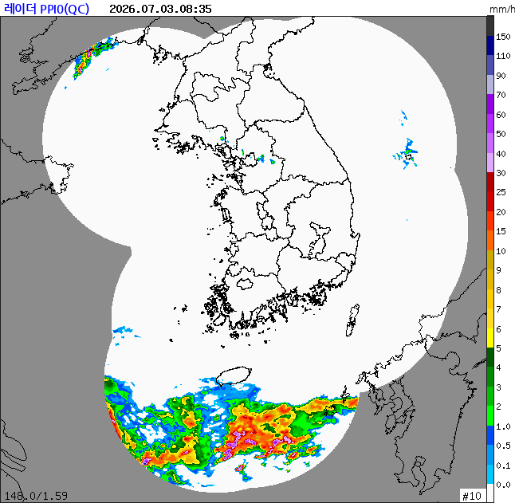
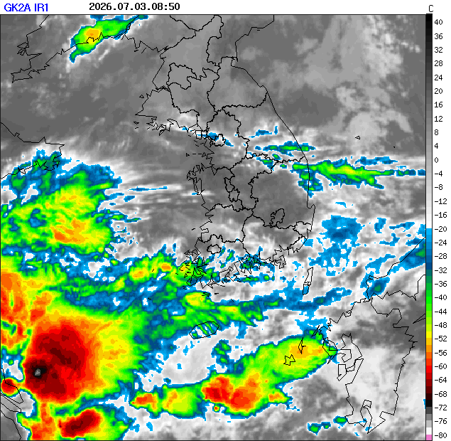
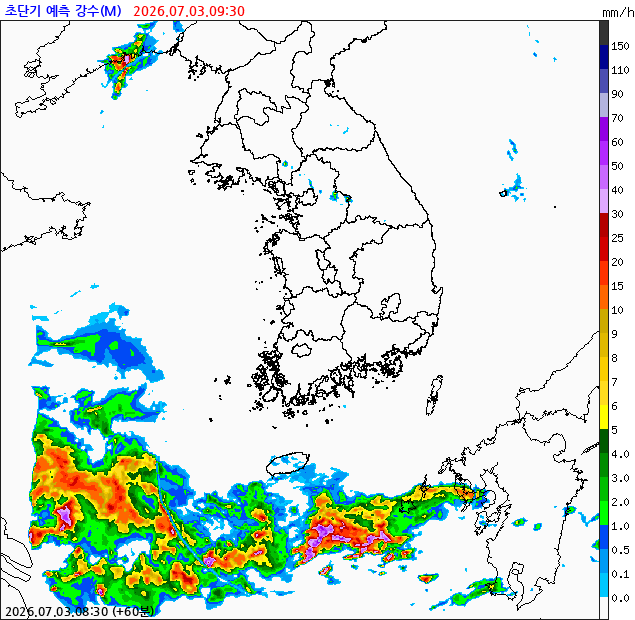
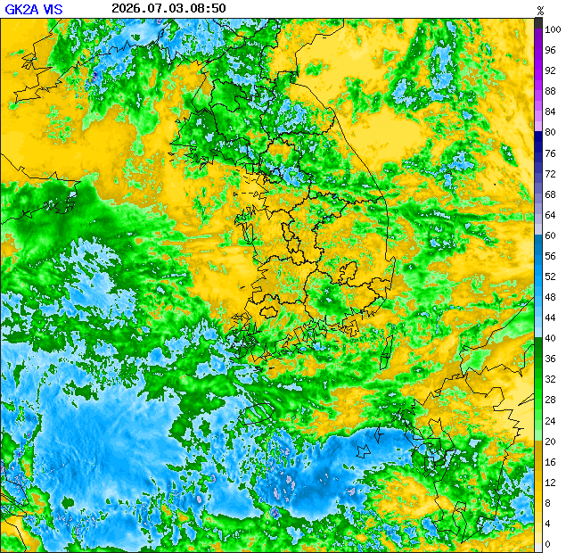
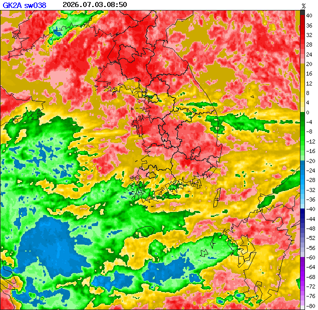
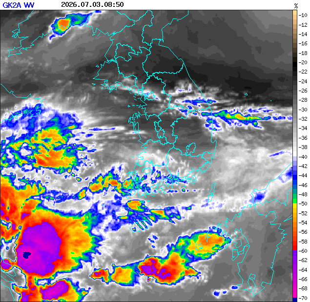
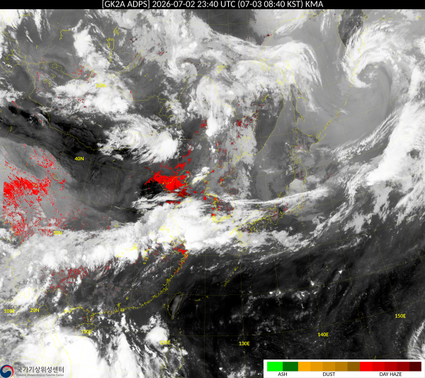

<!-- hass-standards:header:start -->
# KMA Weather for Home Assistant

Home Assistant custom integration for Korea Meteorological Administration (KMA) APIhub weather observations, forecasts, environmental indices and public warnings.

**English** | [한국어](README.ko.md)

<!-- hass-standards:badges:start -->
[](https://github.com/eigger/hass-kma/releases)
[](#installation)
[](hacs.json)
[](https://github.com/eigger/hass-kma/actions/workflows/tests.yml)
[](https://github.com/eigger/hass-kma/actions/workflows/validate.yml)
[](LICENSE)
[](https://github.com/eigger/hass-kma/releases)
<!-- hass-standards:badges:end -->
<!-- hass-standards:header:end -->

Home Assistant custom integration for Korea Meteorological Administration (KMA) APIhub services (`apihub.kma.go.kr`). Delivers real-time weather observations, detailed station measurements, short- and mid-term forecasts, life weather indices (PM10, UV, atmospheric stagnation, pollen risk), severe weather advisories, and radar/satellite imagery.

---

<a name="-key-features"></a>

## Features

* **Standard Weather Entity (`weather.kma_*`)**
  * Current conditions: temperature, humidity, wind direction, wind speed, pressure, and visibility.
  * **Hourly Forecast**: Up to 3 days of hourly village forecasts.
  * **Daily Forecast**: Aggregates the 3-day village forecast daily, merged with mid-term land forecasts (`fct_afs_dl`) for days 4 to 10, providing up to 10 days of continuous daily forecasts.
  * Provides forecast summary texts (`land_forecast_summary`, `marine_forecast_summary`) and active weather warnings as attributes.
* **Detailed Weather Sensors (`sensor.kma_*`)**
  * Temperature, humidity, wind speed, precipitation probability, and 1-hour rainfall.
  * **Land / Marine Forecast Summaries**: Dashboard-ready Korean forecast statements.
  * **Daily Min/Max Temperatures**: Extracted from village forecast extreme values.
  * **Rain/Snow Forecast Window**: Monitors precipitation within 24 hours, exposing 3/6/12-hour flags.
  * **One-Line Weather Summary**: Concise single-string summary combining condition, temperature, daily range, and upcoming rain (ideal for ESL / E-Paper displays).
  * **Apparent Temperature / Dew Point / Discomfort Index**: Real-time calculations based on Steadman and Magnus-Tetens formulas. Discomfort index includes an enum grade sensor (`discomfort_grade`).
* **4 Life Weather Indices**
  * Laundry drying index, car wash index, freeze risk index, food poisoning index — each provided as a 0–100 numerical sensor paired with an ENUM grade sensor (`*_grade`) that auto-translates according to HA system language.
* **Fine Dust (PM10)**
  * Real-time 5-minute ground PM10 observations from the nearest station (`pm10`) with Ministry of Environment standard grade (`pm10_grade`). Hourly average/min/max statistics (`pm10_hourly_avg`) are also provided.
* **UV Index / Atmospheric Stagnation / Pollen Risk Indices**
  * Fetched via KMA living and health weather index APIs with the same authKey.
  * UV and air stagnation update every 3 hours. Pollen risk (oak, pine, weeds) updates twice daily during seasonal periods; reports unavailable outside active seasons.
* **Radar Precipitation Intensity & Radar / Satellite Images**
  * Zone-based radar reflectivity (dBZ) numeric sensor.
  * Provides composite radar images, GK2A satellite images (IR, visible, shortwave IR, water vapor), 60-minute precipitation forecast (QPF), and satellite Asian dust images directly as Home Assistant `image` entities for Picture Entity cards.
* **High-Resolution Surface Observation / Impact Forecast / Snow Depth**
  * Lat/lon coordinate-based observed apparent temperature (`apparent_temperature_observed`).
  * Official KMA heatwave and coldwave impact forecast risk levels (`heat_wave_risk` / `cold_wave_risk`, ENUM).
  * Station-observed snow depth (`snow_depth_observed`).
* **Hazard Information & Weather Commentary**
  * Real-time weather hazard bulletins (`hazard_info`) and daily meteorologist weather commentaries (`weather_commentary`) split into discrete sub-section sensors.
* **Earthquake & Typhoon Tracking**
  * Latest domestic/international earthquake reports and active typhoon positions, pressure, max wind speeds, and movement direction.
* **Severe Weather Safety Sensor (`binary_sensor.kma_*_warning`)**
  * Instantly turns `on` when severe weather warnings (heavy rain, heavy snow, gale, heatwave, coldwave, typhoon, yellow dust, etc.) are issued for the registered region, exposing details and count as attributes.
* **API Authorization & Health Diagnostics**
  * Automatically creates diagnostic sensors for every configured API tracking approval status (`binary_sensor.kma_activation_*`) and cumulative error counts (`sensor.kma_error_count_*`).
* **Seamless Multi-Zone & AWS Station Setup**
  * Select any Home Assistant Zone (`zone.*`) to automatically calculate grid coordinates (nx, ny) and match the optimal forecast region.
  * Search and add any of 720 built-in KMA ASOS/AWS/Gyeonggi-do (SG) automated weather observation stations for 1-minute real-time telemetry.

---

## Requirements

- **Home Assistant:** 2026.9.0 or later.
- **API key:** A KMA APIhub account and an [authKey with the required APIs approved](#apihub-access).

<a name="-installation"></a>

## Installation

<!-- hass-standards:installation:start -->
[](https://my.home-assistant.io/redirect/hacs_repository/?owner=eigger&repository=hass-kma)
<!-- hass-standards:installation:end -->

1. Click the badge above to open the repository in Marketplace.
2. If you need to add it yourself, go to **Settings → Marketplace → Add from link** and enter <https://github.com/eigger/hass-kma>. Connect GitHub if prompted.
3. Select **Install**. Restart Home Assistant if prompted, then continue to [Configuration](#configuration).

<a name="-configuration--usage"></a>

## Configuration

1. In Home Assistant, go to **Settings → Devices & Services → Add Integration**.
2. Search for **KMA** or **기상청** and select it.
3. Enter your **authKey**.
4. In the integration card, click **Add Zone** to register your location. The integration automatically converts zone coordinates into KMA grid values and binds forecast areas.
5. **Add AWS Station (Optional)**: Click **Add Station** to search the built-in catalog of 720 observation stations by name, region, or station ID.
6. **Configure Options**: Click **Configure** on the integration card to adjust scan intervals (5 to 180 minutes; default: 10 minutes).

---

<a name="-prerequisites-kma-apihub-registration"></a>

## APIhub access

1. Register and sign in at the [KMA APIhub Portal](https://apihub.kma.go.kr/).
2. Navigate to API Search or My Page, search for the following APIs, and click **Apply for Use (활용신청)**:
    * Village Forecast (`getVilageFcst`)
    * Short-Term Land Forecast (`fct_afs_dl.php`)
    * Short-Term Marine Forecast (`fct_afs_do.php`)
    * Weather Warnings Status (`wrn_now_data.php`)
    * Forecast Region Info (`fct_shrt_reg.php`) — used for key validation
    * PM10 Observations (`kma_pm10.php`, Surface > Asian Dust PM10)
    * PM10 Hourly Statistics (`dst_pm10_hr.php`)
    * Living Weather Index Service (`LivingWthrIdxServiceV3` — `getUVIdxV3`, `getAirDiffusionIdxV3`)
    * Health Weather Index Service (`HealthWthrIdxServiceV2` — `getOakPollenRiskIdxV2`, `getPinePollenRiskIdxV2`, `getWeedsPollenRiskndxV2`)
    * Weather Radar Info Service (`WthrRadarInfoService/getCompCappiQcdArea`)
    * Radar Composite Download (`typ04/rdr_cmp_file.php`)
    * GK2A Satellite Imagery (`typ03/nph-gk2a_img`) — IR, visible, SWIR, water vapor
    * Ultra-Short-Term Precipitation Graphic (`typ03/nph-qpf_ana_img`)
    * High-Resolution Surface Observation (`sfc_nc_var.php`)
    * Impact Forecast Status (`ifs_fct_pstt.php`)
    * Snow Observation Data (`kma_snow1.php`)
    * Earthquake Notification (`typ09/eqk/urlNewNotiEqk.do`)
    * Typhoon Information (`typ_now.php`)
    * Asian Dust Satellite Imagery (`YdstInfoService/getYdstSatlitImg`)
    * **[Optional]** AWS 1-Minute Observations (`typ01/cgi-bin/url/nph-aws2_min`) — only needed if adding AWS stations.
    * Weather hazard reports (`wrn_inf_rpt.php`) and commentary (`wthr_cmt_rpt.php`) work immediately without separate application.
3. Once approved, copy your **authKey**.

### Diagnostic sensors

The integration automatically creates diagnostic entities under the KMA APIhub device:
* `binary_sensor.kma_activation_<api>` is `on` when the API responds normally and `off` when access is missing (403) or the request fails. The `status` attribute gives the result, such as `ok`, `not_applied` or `error: ...`.
* `sensor.kma_error_count_<api>` reports the error count, `last_error_time` and `current_status`.

API lists in `const.py` define which diagnostics are created. AWS station counts include 403 failures. Hub counts exclude `not_applied`. Both counters reset when the parent entry reloads.

---

<a name="-automation-example"></a>

## Automation example

Send a smartphone alert whenever a severe weather warning is issued for your area:

```yaml
alias: "[Weather] KMA Severe Weather Warning Alert"
description: "Send push notification when a weather warning is issued"
trigger:
  - platform: state
    entity_id: binary_sensor.home_weather_warning  # Adjust to match your entity ID
    from: "off"
    to: "on"
condition: []
action:
  - service: notify.notify
    data:
      title: "⚠️ KMA Weather Warning Issued"
      message: >-
        {{ state_attr('binary_sensor.home_weather_warning', 'warnings_count') }} warning(s) currently active.

        Details:
        
        - {{ w.region }} {{ w.warning_name }}{{ w.level_name }} (Effective: {{ w.effective_time }})
        
mode: single
```

---

<a name="-provided-entities--sensors"></a>

## Entities and sensors

### Local weather and forecasts

Updates every 10 min unless noted.

| Entity | Source and example |
| --- | --- |
| **Weather** · `weather.kma_<zone>` | Village forecast (`getVilageFcst`) · `sunny`, `rainy`, etc. |
| **Temperature** · `sensor.kma_<zone>_temperature` | Village forecast · `19.5` ℃ |
| **Humidity** · `sensor.kma_<zone>_humidity` | Village forecast · `65` % |
| **Wind Speed** · `sensor.kma_<zone>_wind_speed` | Village forecast · `3.2` m/s |
| **Wind Direction** · `sensor.kma_<zone>_wind_direction` | Village forecast · `WNW` (16-point cardinal) |
| **Precipitation Probability** · `sensor.kma_<zone>_precipitation_probability` | Village forecast · `20` % |
| **Hourly Precipitation** · `sensor.kma_<zone>_precipitation` | Village forecast · `0.0` mm |
| **Today Min Temp** · `sensor.kma_<zone>_daily_min_temp` | Village forecast extreme scan · `11.0` ℃ |
| **Today Max Temp** · `sensor.kma_<zone>_daily_max_temp` | Village forecast extreme scan · `26.0` ℃ |
| **Expected Rain Time** · `sensor.kma_<zone>_precipitation_expected_time` | Forecast merge · `2026-07-03T16:00:00+09:00` |
| **Rain Expected Soon** · `binary_sensor.kma_<zone>_precipitation_expected` | Rain within 6 hours · `on` / `off` |
| **Apparent Temperature** · `sensor.kma_<zone>_apparent_temperature` | Steadman formula · `21.8` ℃ |
| **Dew Point** · `sensor.kma_<zone>_dew_point` | Magnus-Tetens formula · `15.2` ℃ |
| **Discomfort Index / Grade** · `sensor.kma_<zone>_discomfort_index` / `_grade` | Temperature & humidity · `72.3` / `normal` |
| **Laundry Index / Grade** · `sensor.kma_<zone>_laundry_index` / `_grade` | Temperature, humidity, wind · `85` / `good` |
| **Car Wash Index / Grade** · `sensor.kma_<zone>_car_wash_index` / `_grade` | 72h rain outlook · `90` / `excellent` |
| **Freeze Risk Index / Grade** · `sensor.kma_<zone>_freeze_risk_index` / `_grade` | 48h min temp · `10` / `low` |
| **Food Poisoning Index / Grade** · `sensor.kma_<zone>_food_poisoning_index` / `_grade` | Temp & humidity model · `42` / `attention` |
| **One-Line Weather Summary** · `sensor.kma_<zone>_one_line_summary` | Comprehensive condition string · `Sunny, 19.5°C (11.0°C/26.0°C)` |
| **Land Forecast Summary** · `sensor.kma_<zone>_land_forecast_summary` | Short-term land forecast (`fct_afs_dl`) · `Partly cloudy` · Daily 05:00, 17:00 |
| **Marine Forecast Summary** · `sensor.kma_<zone>_marine_forecast_summary` | Short-term marine forecast (`fct_afs_do`) · `Waves 0.5–1.0m` · Daily 05:00, 17:00 |
| **PM10 Fine Dust / Grade** · `sensor.kma_<zone>_pm10` / `_grade` | PM10 observations (`kma_pm10.php`) · `28` ㎍/㎥ / `good` |
| **PM10 Hourly Average** · `sensor.kma_<zone>_pm10_hourly_avg` | Hourly stats (`dst_pm10_hr.php`) · `31.5` ㎍/㎥ |
| **UV Index / Grade** · `sensor.kma_<zone>_uv_index` / `_grade` | Living index (`getUVIdxV3`) · `6` / `high` |
| **Air Stagnation Index / Grade** · `sensor.kma_<zone>_air_stagnation_index` / `_grade` | Diffusion index (`getAirDiffusionIdxV3`) · `50` / `moderate` |
| **Pollen Risk (Oak) / Grade** · `sensor.kma_<zone>_oak_pollen_risk` / `_grade` | Pollen index (`getOakPollenRiskIdxV2`) · `1` / `moderate` |
| **Pollen Risk (Pine) / Grade** · `sensor.kma_<zone>_pine_pollen_risk` / `_grade` | Pollen index (`getPinePollenRiskIdxV2`) · `1` / `moderate` |
| **Pollen Risk (Weeds) / Grade** · `sensor.kma_<zone>_weed_pollen_risk` / `_grade` | Pollen index (`getWeedsPollenRiskndxV2`) · `1` / `moderate` |
| **Radar Intensity (dBZ)** · `sensor.kma_<zone>_radar_precipitation` | Radar CAPPI (`getCompCappiQcdArea`) · `32.5` dBZ |
| **Radar Intensity Grade** · `sensor.kma_<zone>_radar_precipitation_grade` | Classified from dBZ · `Light Rain` |
| **Observed Apparent Temp** · `sensor.kma_<zone>_apparent_temperature_observed` | Surface observation (`sfc_nc_var.php`) · `27.0` ℃ |
| **Heatwave / Coldwave Risk** · `sensor.kma_<zone>_heat_wave_risk` / `_cold_wave_risk` | Impact forecast (`ifs_fct_pstt.php`) · `None` / `Caution` |
| **Observed Snow Depth** · `sensor.kma_<zone>_snow_depth_observed` | Snow observation (`kma_snow1.php`) · `0.0` cm |
| **Hazard Information** · `sensor.kma_<zone>_hazard_info` (+ `_section_1`~`_3`) | Weather warning reports (`wrn_inf_rpt.php`) · Title (sections in attributes) |
| **Weather Commentary** · `sensor.kma_<zone>_weather_commentary` (+ `_section_1`~`_8`) | Weather commentary (`wthr_cmt_rpt.php`) · Title (sections in attributes) |
| **Weather Warning Safety Sensor** · `binary_sensor.kma_<zone>_warning` | Warning bulletins (`wrn_now_data.php`) · `on` / `off` |

### Nationwide feeds and imagery

Updates every 10 min.

| Entity | Source and example |
| --- | --- |
| **Recent Earthquake** · `sensor.kma_recent_earthquake` | Earthquake alerts (`urlNewNotiEqk.do`) · `4.3` (mag; loc/time in attrs) |
| **Typhoon Number** · `sensor.kma_typhoon_number` | Typhoon alerts (`typ_now.php`) · `0` (none) / `5` (Typhoon #5) |
| **Radar Composite Image** · `image.kma_radar_image` | Radar composite (`rdr_cmp_file.php`) · State=Timestamp, Output=PNG |
| **Satellite (GK2A) IR Image** · `image.kma_satellite_image` | GK2A IR (`nph-gk2a_img`) · State=Timestamp, Output=PNG |
| **QPF Forecast Image (+60m)** · `image.kma_precipitation_forecast_image` | QPF analysis (`nph-qpf_ana_img`) · State=Timestamp, Output=PNG |
| **Satellite Visible Image** · `image.kma_satellite_visible_image` | GK2A visible (`nph-gk2a_img?obs=vi006`) · State=Timestamp, Output=PNG |
| **Satellite Shortwave IR Image** · `image.kma_satellite_shortwave_ir_image` | GK2A SWIR (`nph-gk2a_img?obs=sw038`) · State=Timestamp, Output=PNG |
| **Satellite Water Vapor Image** · `image.kma_satellite_water_vapor_image` | GK2A WV (`nph-gk2a_img?obs=wv069`) · State=Timestamp, Output=PNG |
| **Dust Satellite Image (IDI)** · `image.kma_dust_satellite_image` | Yellow dust imagery (`getYdstSatlitImg`) · State=Timestamp, Output=PNG |

### AWS station observations

Updates about every 5 minutes.

| Entity | Source and example |
| --- | --- |
| **Observation Time** · `sensor.aws_<station>_observation_time` | AWS 1-min data (`nph-aws2_min`) · `2026-07-03T14:31:00+09:00` |
| **Temperature** · `sensor.aws_<station>_temperature` | AWS 1-min data (TA) · `23.1` ℃ |
| **Humidity** · `sensor.aws_<station>_humidity` | AWS 1-min data (HM) · `71` % |
| **Dew Point** · `sensor.aws_<station>_dew_point` | AWS 1-min data (TD) · `17.7` ℃ |
| **1-Min Avg Wind Direction** · `sensor.aws_<station>_wind_direction_1_min` | AWS 1-min data (WD1) · `225` ° (Calm 360 = `unknown`) |
| **1-Min Avg Wind Speed** · `sensor.aws_<station>_wind_speed_1_min` | AWS 1-min data (WS1) · `1.8` m/s |
| **Gust Direction** · `sensor.aws_<station>_gust_direction` | AWS 1-min data (WDS) · `180` ° |
| **Gust Speed** · `sensor.aws_<station>_gust_speed` | AWS 1-min data (WSS) · `6.2` m/s |
| **10-Min Avg Wind Direction** · `sensor.aws_<station>_wind_direction_10_min` | AWS 1-min data (WD10) · `190` ° |
| **10-Min Avg Wind Speed** · `sensor.aws_<station>_wind_speed_10_min` | AWS 1-min data (WS10) · `2.4` m/s |
| **15-Min Rain** · `sensor.aws_<station>_rain_15_min` | AWS 1-min data (RN-15m) · `0.5` mm |
| **60-Min Rain** · `sensor.aws_<station>_rain_60_min` | AWS 1-min data (RN-60m) · `2.0` mm |
| **12-Hour Rain** · `sensor.aws_<station>_rain_12_h` | AWS 1-min data (RN-12H) · `8.5` mm |
| **Today Rain** · `sensor.aws_<station>_rain_today` | AWS 1-min data (RN-DAY) · `14.0` mm |
| **Station Pressure** · `sensor.aws_<station>_station_pressure` | AWS 1-min data (PA) · `1013.4` hPa |
| **Sea Level Pressure** · `sensor.aws_<station>_sea_level_pressure` | AWS 1-min data (PS) · `1015.8` hPa |

> Nationwide feeds (earthquake, typhoon, radar/satellite images) are fetched once centrally, then mapped per Zone device for dashboard convenience. Hub device contains system diagnostics.
>
> **Note on Image Entities**: The entity state represents the last update timestamp, while the camera/image stream delivers PNG image data. Use Home Assistant Picture Entity cards to display them on your dashboard.

---

<a name="-detailed-sensor-information"></a>

## Sensor details

### One-Line Weather Summary (`one_line_summary`)
A unified text sensor formatted specifically for ESL (Electronic Shelf Labels), E-Paper displays, and dashboard subtitle badges. Formats automatically according to your Home Assistant language setting:
* English: `Clear, 19.5°C (11.0°C/26.0°C)`, `Overcast, 15.0°C (12.0°C/18.0°C), Rain expected around 16:00`
* Korean: `맑음, 19.5°C (11.0°C/26.0°C)`, `흐림, 15.0°C (12.0°C/18.0°C), 16시경 비 예보`

### 4 Life Weather Indices
Each index provides a 0–100 numerical value (`_index`) and an ENUM grade (`_grade`) with advice guidelines in attributes:
* **Laundry Drying Index**: Very Good / Good / Normal / Not Recommended
* **Car Wash Index**: Very Good / Recommend Delay / Not Recommended / Avoid
* **Freeze Risk Index**: Low / Moderate / High / Very High
* **Food Poisoning Index**: Attention / Caution / Warning / Danger

### Fine Dust (PM10)
Uses real-time 5-minute ground observations from the nearest active station.
* `pm10`: Concentration (㎍/㎥).
* `pm10_grade`: Ministry of Environment grade (Good 0–30 / Normal 31–80 / Bad 81–150 / Very Bad 151+).
* `pm10_hourly_avg`: Hourly average, minimum, and maximum statistics.
* Exposes `station_id` and `station_name` attributes so you can verify the exact monitoring location.

### Radar Precipitation Intensity & Imagery Gallery
* **Radar Intensity (dBZ)**: Reflectivity value queried by administrative zone. Categorized into 6 human-friendly levels via `radar_precipitation_grade`: None, Drizzle, Light Rain, Moderate Rain, Heavy Rain, Torrential Rain.
* **Image Entities**: 7 live PNG channels updating every ~10 minutes.

**Sample Images** (Live samples retrieved via APIhub authKey):

| `image.kma_radar_image` (Radar Composite) | `image.kma_satellite_image` (Satellite IR) |
| --- | --- |
|  |  |

| `image.kma_precipitation_forecast_image` (QPF +60min Forecast) | `image.kma_satellite_visible_image` (Satellite Visible) |
| --- | --- |
|  |  |

| `image.kma_satellite_shortwave_ir_image` (Satellite Shortwave IR) | `image.kma_satellite_water_vapor_image` (Satellite Water Vapor) |
| --- | --- |
|  |  |

### UV Index / Atmospheric Stagnation / Pollen Risk
* `uv_index` (3-hour interval) + `uv_index_grade` (Low / Moderate / High / Very High / Extreme according to WHO standards).
* `air_stagnation_index` + `air_stagnation_grade` (Numerical scale mapped to diffusion quality).
* `oak_pollen_risk` / `pine_pollen_risk` / `weed_pollen_risk`: Seasonal health indices (Oak/Pine in March–June, Weeds in August–October). Includes tomorrow and day-after-tomorrow outlooks in attributes.

### Surface Observations / Impact Forecasts / Snow Depth
* **Observed Apparent Temp** (`apparent_temperature_observed`): High-resolution multi-variable surface observation (`sfc_nc_var.php`) calculated at the exact latitude/longitude of your zone.
* **Impact Forecasts** (`heat_wave_risk` / `cold_wave_risk`): Official KMA heatwave and coldwave risk classifications.
* **Observed Snow Depth** (`snow_depth_observed`): Ground station snow measurements in cm.

### Weather Hazard Bulletins & Commentary
Official meteorological bulletins published by regional weather offices:
* **Hazard Information** (`hazard_info`): Flash bulletins for fog, thunderstorms, downpours, etc.
* **Weather Commentary** (`weather_commentary`): Comprehensive daily briefings. Dedicated fixed slots (`_section_1` to `_section_8`) allow deterministic card and automation binding.

### Earthquake & Typhoon
* **Earthquake Information** (`sensor.kma_recent_earthquake`): Details of recent domestic and major global earthquakes (magnitude, epicenter, timestamp).
* **Typhoon Tracking** (`sensor.kma_typhoon_number`): Active typhoon identifier, location coordinates, pressure, and trajectory.

### Asian Dust Satellite Imagery
GK2A satellite Asian Dust (IDI) imagery (`image.kma_dust_satellite_image`).



### AWS 1-Minute Station Telemetry (Optional)
Supports real-time 1-minute telemetry from 720 built-in ASOS/AWS/SG stations across South Korea:
* **Isolated Subentry**: Add or remove weather stations independently from your location zones.
* **Fixed 5-minute Polling**: Throttled to ~301 seconds to protect rate limits and prevent duplicate calls.
* **Resilience**: Cached observations persist across network disruptions and Home Assistant reboots until fresh data arrives (`observation_fresh` flag indicates data timeliness).

---

<a name="-future-roadmap"></a>

## Roadmap

1. **Marine Buoy Observations**: Fetch real-time wave height, water temperature, and pressure via `kma_buoy2.php` / `sea_obs.php`.
2. **Marine Sector Forecasts**: +75h sea forecasts via `marine_small_zone.php` / `marine_large_zone.php`.
3. **Impact Forecast Heat/Cold Maps**: Map graphics via `ifs_ilvl_dmap.php`.

---

<a name="-documentation"></a>

## Documentation

- [User Guide](docs/user-guide.md) ([한국어](docs/ko/user-guide.md))
- [Troubleshooting](docs/troubleshooting.md) ([한국어](docs/ko/troubleshooting.md))
- [Development Guide](docs/development.md)

---

<!-- hass-standards:support:start -->
## Support

- [Issues](https://github.com/eigger/hass-kma/issues): Report bugs or request features.
- [Discussions](https://github.com/eigger/hass-kma/discussions): Ask questions and share your experience.
<!-- hass-standards:support:end -->

<!-- hass-standards:related-projects:start -->
<!-- hass-standards:related-projects:end -->

<!-- hass-standards:license:start -->
## License

Released under the [MIT License](LICENSE).
<!-- hass-standards:license:end -->
